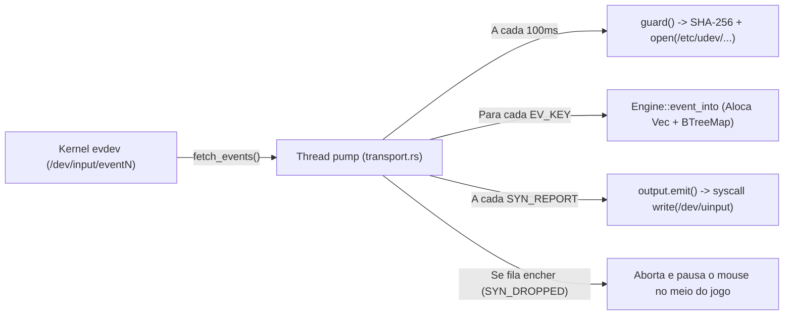

# Plano de Otimização de Latência e Estabilidade para Alta Frequência (1000 Hz – 8000 Hz)

Este plano detalha as melhorias arquiteturais e de código para tornar o backend nativo de mouse e teclado do BindForge (`evdev` → `uinput`) imune a picos de latência, micro-travadas de CPU em jogos pesados e sobrecarga de chamadas de sistema em periféricos de altíssima taxa de atualização (**4000 Hz / 8000 Hz**), preservando a regra `unsafe_code = forbid` e a execução sem privilégios de `root`.

---

## Diagnóstico do Caminho Crítico Atual (*Hot Path*)

Ao inspecionar o código atual em [transport.rs](file:///home/hugostoso/Dev/Projects/Personal/bindforge/crates/platform-linux/src/native/transport.rs), [engine.rs](file:///home/hugostoso/Dev/Projects/Personal/bindforge/crates/platform-linux/src/native/engine.rs) e [store.rs](file:///home/hugostoso/Dev/Projects/Personal/bindforge/crates/bindforge-access/src/store.rs), identificamos **5 gargalos específicos** sob alta frequência:

1. **Queda abrupta por `SYN_DROPPED`:** Em 8000 Hz, a fila de eventos do kernel enche em ~8 ms se o jogo travar compilando um *shader*. Hoje, [`pump`](file:///home/hugostoso/Dev/Projects/Personal/bindforge/crates/platform-linux/src/native/transport.rs#L249) encerra o remapeamento imediatamente ao receber `SYN_DROPPED` (`code == 3`), desativando o mouse no meio da partida.
2. **I/O de disco e cálculo de SHA-256 dentro da thread do mouse a cada 100 ms:** O callback `guard()` configurado em [`run_kde` (`main.rs`)](file:///home/hugostoso/Dev/Projects/Personal/bindforge/crates/bindforge-daemon/src/main.rs#L75-L80) chama [`ensure_not_revoked`](file:///home/hugostoso/Dev/Projects/Personal/bindforge/crates/bindforge-access/src/store.rs#L102-L104) a cada 100 ms **dentro da própria thread `pump`**. Isso formata strings, calcula um hash `Sha256::digest` e faz 4 chamadas de sistema ao sistema de arquivos (`lstat` em `/etc`, `/etc/udev`, `/etc/udev/rules.d` e `open` no arquivo `.revoked`) no mesmo loop que processa o movimento do cursor.
3. **Alocações na *heap* (`malloc`/`free`) a cada clique ou tecla:** Em [`Plan::output`](file:///home/hugostoso/Dev/Projects/Personal/bindforge/crates/platform-linux/src/native/engine.rs#L58) e [`Engine::event_into`](file:///home/hugostoso/Dev/Projects/Personal/bindforge/crates/platform-linux/src/native/engine.rs#L116-L119), todo pressionamento aloca um novo `Vec<u16>` e insere nós dinâmicos em `BTreeMap`/`BTreeSet`, desalocando ao soltar.
4. **Múltiplas syscalls `write()` para movimentos acumulados:** Se o escalonador do Linux atrasar 0,5 ms num mouse de 8000 Hz, [`source.fetch_events()`](file:///home/hugostoso/Dev/Projects/Personal/bindforge/crates/platform-linux/src/native/transport.rs#L241) retorna 4 relatórios `SYN_REPORT` na mesma leitura. O loop atual chama [`emit(&mut output, &out)`](file:///home/hugostoso/Dev/Projects/Personal/bindforge/crates/platform-linux/src/native/transport.rs#L258) 4 vezes seguidas, quadruplicando as syscalls `write` no `/dev/uinput` e o trabalho do compositor KWin.
5. **Prioridade de CPU padrão:** A thread do remapeador compete de igual para igual com threads pesadas de renderização do jogo.

---

## Mudanças Propostas

### Etapa 1: Recuperação Transparente de `SYN_DROPPED` (Ressincronização de Estado)
**Arquivos afetados:**
* [engine.rs](file:///home/hugostoso/Dev/Projects/Personal/bindforge/crates/platform-linux/src/native/engine.rs)
* [transport.rs](file:///home/hugostoso/Dev/Projects/Personal/bindforge/crates/platform-linux/src/native/transport.rs)

**O que será feito:**
* Adicionar o método `Engine::resync(&mut self, physical_pressed: impl Fn(u16) -> bool, out: &mut Vec<InputEvent>)` em [`Engine`](file:///home/hugostoso/Dev/Projects/Personal/bindforge/crates/platform-linux/src/native/engine.rs#L92-L142):
  * Verifica todas as teclas/botões atualmente registrados em `self.held` e `self.blocked`.
  * Se o botão/tecla físico **não estiver mais pressionado** segundo o kernel (`!physical_pressed(code)`), libera imediatamente as teclas sintéticas correspondentes no buffer `out` e remove de `held`/`blocked`.
  * Se o botão físico continuar pressionado no hardware, mantém o estado sem interromper o arrasto (*drag*) ou mira.
* Em [`pump` (`transport.rs`)](file:///home/hugostoso/Dev/Projects/Personal/bindforge/crates/platform-linux/src/native/transport.rs#L248-L250), ao receber `EventType::SYNCHRONIZATION` com `code == 3` (`SYN_DROPPED`):
  1. Descarta os eventos parciais acumulados antes do `SYN_DROPPED` (`frame.clear()`, `emergency.clear()`);
  2. Consulta [`source.get_key_state()`](file:///home/hugostoso/Dev/Projects/Personal/bindforge/crates/platform-linux/src/native/transport.rs#L164) no kernel;
  3. Executa `engine.resync(...)` e emite eventuais liberações no `output`;
  4. Continua a captura normalmente (só encerrando se o próprio `get_key_state()` ou `emit()` falhar por desconexão física).

---

### Etapa 2: Eliminar Alocações Dinâmicas no [`Engine`](file:///home/hugostoso/Dev/Projects/Personal/bindforge/crates/platform-linux/src/native/engine.rs) (*Zero-Allocation Hot Path*)
**Arquivo afetado:**
* [engine.rs](file:///home/hugostoso/Dev/Projects/Personal/bindforge/crates/platform-linux/src/native/engine.rs)

**O que será feito:**
* Criar um tipo compacto `ActionCodes` (baseado em array fixo na *stack*, ex.: `[u16; 16]` + `len: u8`, `Copy`), já que a regra de negócio na linha 64 de [`compile_action`](file:///home/hugostoso/Dev/Projects/Personal/bindforge/crates/platform-linux/src/native/engine.rs#L64) já limita qualquer atalho a no máximo **16 teclas** (`keys.len() > 16`).
* Substituir `Vec<u16>` por `ActionCodes` (ou fatia `&[u16]`) no retorno de [`Plan::output`](file:///home/hugostoso/Dev/Projects/Personal/bindforge/crates/platform-linux/src/native/engine.rs#L58) e no mapa `held` do [`Engine`](file:///home/hugostoso/Dev/Projects/Personal/bindforge/crates/platform-linux/src/native/engine.rs#L93).
* Substituir os contadores `refs` e estados por estruturas pré-alocadas (ou manter capacidade fixa sem realocação).
* **Resultado:** Zero chamadas ao alocador global (`malloc`/`free`) ao pressionar, repetir ou soltar qualquer botão do mouse ou tecla do teclado.

---

### Etapa 3: Coalescência de Quadros de Movimento no Mesmo Lote (`fetch_events`)
**Arquivo afetado:**
* [transport.rs](file:///home/hugostoso/Dev/Projects/Personal/bindforge/crates/platform-linux/src/native/transport.rs)

**O que será feito:**
* No loop [`pump`](file:///home/hugostoso/Dev/Projects/Personal/bindforge/crates/platform-linux/src/native/transport.rs#L247-L266), diferenciar quadros que contêm eventos de tecla/botão (`EventType::KEY`) de quadros puramente de movimento relativo (`REL_X`, `REL_Y`, `REL_WHEEL`, `REL_HWHEEL`, etc.) dentro do **mesmo lote** retornado por uma única chamada não-bloqueante de `source.fetch_events()`:
  * Quando o hardware e a CPU estão em dia (1 quadro por leitura `fetch_events`), o quadro é emitido imediatamente no `SYN_REPORT`, com **latência zero de espera**.
  * Se o escalonador atrasou e `fetch_events()` trouxe múltiplos quadros acumulados na fila do kernel, quadros consecutivos que contenham **apenas movimento** (`REL_X`/`REL_Y`) têm seus deltas somados e são emitidos em um único `output.emit(&out)` antes de qualquer quadro com clique (`EV_KEY`) ou ao final do lote lido.
  * Qualquer quadro contendo `EventType::KEY` (pressionar/soltar botão) força a emissão imediata do movimento acumulado anterior e emite o clique no seu próprio relatório `SYN_REPORT`, preservando a ordem exata entre mira e clique.

---

### Etapa 4: Otimização da Verificação de Autorização (`CaptureAuthorization` e `ensure_not_revoked`)
**Arquivos afetados:**
* [lib.rs (`bindforge-access`)](file:///home/hugostoso/Dev/Projects/Personal/bindforge/crates/bindforge-access/src/lib.rs)
* [store.rs (`bindforge-access`)](file:///home/hugostoso/Dev/Projects/Personal/bindforge/crates/bindforge-access/src/store.rs)
* [transport.rs (`platform-linux`)](file:///home/hugostoso/Dev/Projects/Personal/bindforge/crates/platform-linux/src/native/transport.rs)

**O que será feito:**
1. **Pré-computar a regra e o nome do arquivo `.revoked` em [`Target`](file:///home/hugostoso/Dev/Projects/Personal/bindforge/crates/bindforge-access/src/device.rs):**
   * Hoje, cada chamada a [`revoked(target)`](file:///home/hugostoso/Dev/Projects/Personal/bindforge/crates/bindforge-access/src/store.rs#L99-L101) reconstrói a regra udev em `String` e recalcula o hash `Sha256`. Armazenando o `revoked_filename` e a `rule` diretamente no `Target` (ou pré-calculando no closure do `guard`), eliminamos 100% das alocações e do cálculo de SHA-256 periódico.
2. **Evitar checagem no meio de uma rajada de pacotes:**
   * Em [`pump`](file:///home/hugostoso/Dev/Projects/Personal/bindforge/crates/platform-linux/src/native/transport.rs#L236), priorizar o esvaziamento imediato do `fetch_events()` quando acordado por entrada física, e limitar o ritmo de `authorization.check()` para não atrasar o despacho de pacotes USB consecutivos.

---

### Etapa 5: Prioridade de Escalonamento do Processo e da Thread de Input
**Arquivos afetados:**
* [bindforge-daemon.service](file:///home/hugostoso/Dev/Projects/Personal/bindforge/integrations/systemd/bindforge-daemon.service)
* [transport.rs](file:///home/hugostoso/Dev/Projects/Personal/bindforge/crates/platform-linux/src/native/transport.rs)

**O que será feito:**
* No serviço de usuário [`bindforge-daemon.service`](file:///home/hugostoso/Dev/Projects/Personal/bindforge/integrations/systemd/bindforge-daemon.service), adicionar diretivas compatíveis com sessão de usuário para reduzir a preempção do daemon durante jogos:
  * `Nice=-10` (ou `IOSchedulingClass=realtime` / `IOSchedulingPriority=0`, que o systemd aplica quando os limites RLIMIT do usuário permitem, ignorando graciosamente caso contrário).

---

## Plano de Verificação e Testes

1. **Testes Unitários Novos em `engine.rs` e `transport.rs`:**
   * **Teste de `SYN_DROPPED` com botão mantido e botão solto:** Simular um fluxo com botão lateral pressionado → `SYN_DROPPED` → validar que se o botão físico continua pressionado, a tecla `V` não é solta; e se o botão físico foi solto durante a perda, a tecla `V` é liberada imediatamente sem encerrar o worker.
   * **Teste de Coalescência de Movimento:** Simular um único lote com múltiplos relatórios `REL_X`/`REL_Y` seguidos de um clique `BTN_LEFT`, garantindo que os deltas `X`/`Y` anteriores ao clique sejam somados com precisão e emitidos **antes** do clique.
   * **Teste de `ActionCodes` sem alocação:** Validar todos os cenários existentes (atalhos de até 16 teclas, modificadores compartilhados, troca de perfil com tecla pressionada).
2. **Suíte Completa do Workspace:**
   * Executar `cargo test --workspace --all-features --locked --offline` e `cargo check --workspace --all-targets --all-features --locked --offline`.
3. **Atualização da Documentação:**
   * Atualizar [docs/native-input.md](file:///home/hugostoso/Dev/Projects/Personal/bindforge/docs/native-input.md) refletindo a recuperação de `SYN_DROPPED` e a coalescência de quadros em lotes atrasados.
